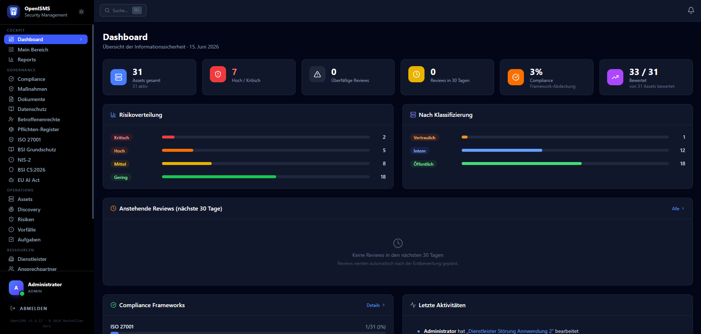
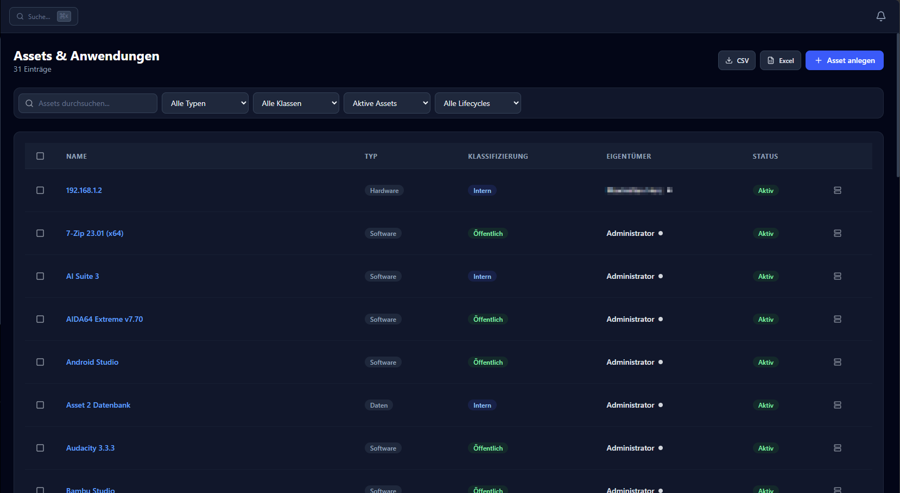
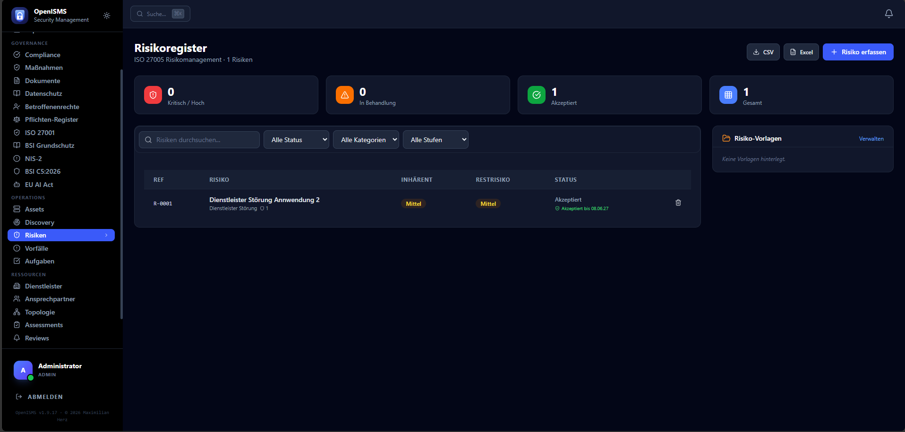
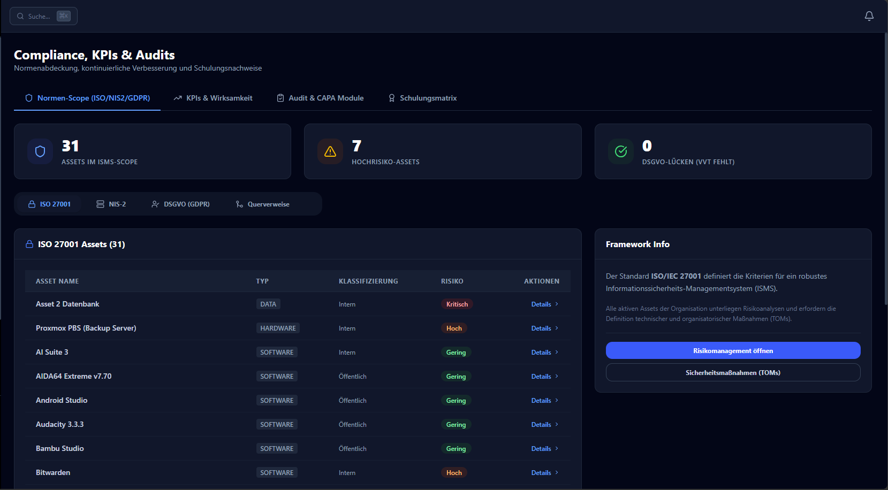
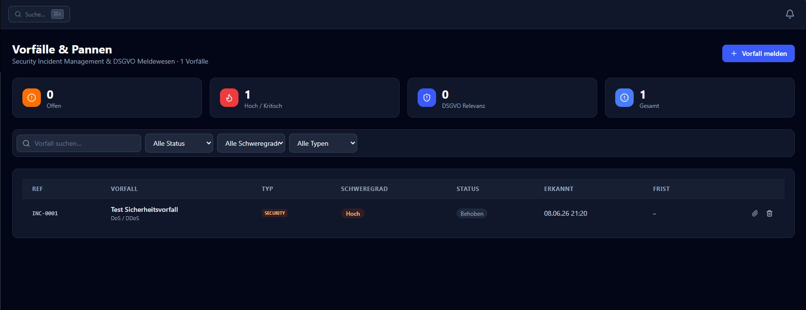
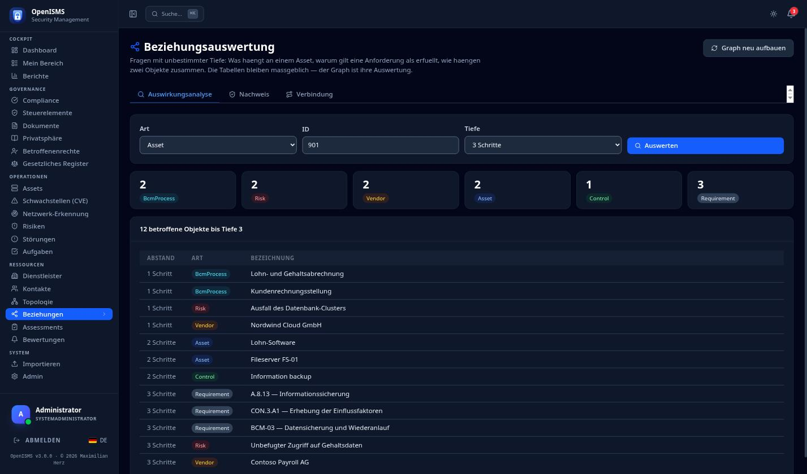
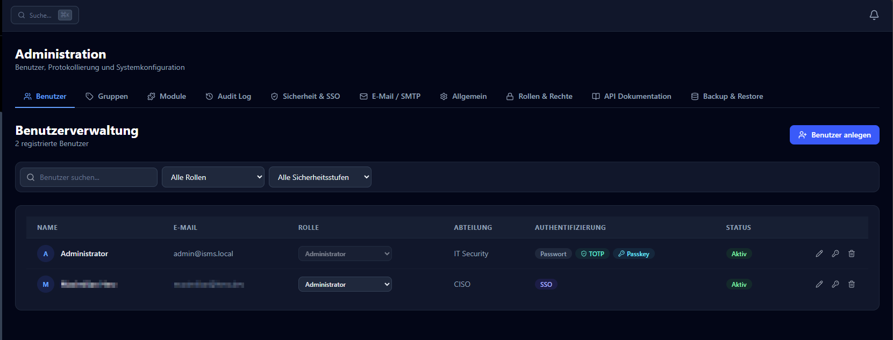

# OpenISMS

**An open, practice-oriented Information Security Management System for
ISO 27001, NIS-2, GDPR, BSI IT-Grundschutz, BSI C5, TISAX, DORA and the EU AI
Act.** Built on Node.js, React and PostgreSQL — a GRCForge project.




---

## Why OpenISMS

- **One register for everything.** Assets, risks, controls, policies, incidents,
  vendors and evidence live in one place and reference each other — one control
  can satisfy ISO 27001, NIS-2, BSI and C5 requirements at the same time.
- **Evidence, not checkboxes.** Every change is audit-logged and signed;
  documents are hash-verified; the relationship analysis shows *why* a
  requirement counts as met.
- **Made for German and European requirements.** NIS-2 together with the German
  BSIG duties, BSI IT-Grundschutz, C5:2026, TR-02102 figures, GDPR processing
  register and DPIA.
- **AI-ready.** A built-in MCP server lets assistants such as Claude work with
  your ISMS — under the same permissions as every user.
- **Self-hosted.** One container plus PostgreSQL. Your data stays with you.

---

## Documentation

The full documentation is also available as the
**[OpenISMS Wiki](https://github.com/GRCForge/OpenISMS/wiki)**, generated from
these files plus getting-started, upgrade, troubleshooting, FAQ, architecture
and glossary pages.

| Document | Contents |
|---|---|
| [Features](docs/FEATURES.md) | Every module and function in detail |
| [Installation & configuration](docs/CONFIGURATION.md) | Install options, environment variables, SSO, updates, backups |
| [Security configuration](docs/SECURITY-CONFIGURATION.md) | Hardening guide and production checklist |
| [MCP integration](docs/MCP.md) | Connecting Claude and other AI assistants; all 245 tools |
| [Security policy](SECURITY.md) | Supported versions, reporting vulnerabilities |
| [Contributing](CONTRIBUTING.md) | How to contribute |
| [Release notes](docs/) | `docs/RELEASE-NOTES-v*.md` |

---

## Features at a glance

| Area | Highlights |
|---|---|
| **Assets** | Asset register (ISO 27001 A.5.9) with classification, hosting, lifecycle, RTO/RPO, owners, dependencies and documents; topology graph |
| **Vulnerabilities** | CPE matching and CVEs from OSV.dev, NVD and Shodan CVEDB; nightly refresh |
| **Discovery** | Network scan, discovery agent, CheckMK and spreadsheet import — always through an approval queue, never straight into the register |
| **Risk management** | CIA protection needs, ISO 27005 risk register with 5×5 matrix, inherent and residual risk, management risk acceptance with expiry |
| **Controls & SoA** | ISO 27001 Annex A, BSI, NIS-2 and custom controls; cross-framework mapping with 277 built-in mappings |
| **Frameworks** | ISO 27001:2022 · NIS-2 / BSIG with self-check and gap analysis · BSI IT-Grundschutz · BSI C5:2026 · TISAX · DORA · EU AI Act · legal register |
| **Incidents** | NIS-2 and GDPR reporting deadlines (24 h / 72 h), root cause, lessons learned, authority reference numbers |
| **Threat landscape** | Source register, RSS/Atom/CISA KEV intake, assessment and hand-over into risks and tasks (NIS-2 Art. 21(2)(a), ISO A.5.7) |
| **Policies** | Versioned policy library, templates, read acknowledgements |
| **Vendors** | Supply chain register, contacts, DPA tracking, AI triage of vendor documents |
| **Privacy** | GDPR processing register (Art. 30), DPIA (Art. 35), data subject requests (Art. 15–22), data flows |
| **Assurance** | Audits and findings, KPIs, training records, BCM (BIA, exercises), pentest tracking |
| **Reporting** | Dashboard, ISMS health score, 12-month trends, management review sign-off, Excel export |
| **Relationship analysis** | Impact, evidence paths and connections across all modules (Apache AGE) |
| **Collaboration** | Tasks for users and groups, automated recurring tasks, reminders, e-mail and browser push |
| **Administration** | Roles as permission sets (8 built-in plus custom), granted through groups that combine roles, editable permission matrix, module switches, signed audit log, backup and restore |
| **Access** | Password + TOTP, passkeys (WebAuthn), SSO via any OIDC provider, API tokens, REST API with OpenAPI, MCP server |
| **UX** | English, German, Spanish · installable PWA · command palette · mobile layout |

Modules you do not need can be switched off. → [All features](docs/FEATURES.md)

---

## Quick start

Docker Compose with the bundled PostgreSQL (incl. Apache AGE):

```bash
git clone https://github.com/grcforge/openisms.git
cd openisms
cp .env.example .env
```

Set at least these values in `.env` (generate secrets with `openssl rand -hex 32`):

```dotenv
POSTGRES_PASSWORD=...
JWT_SECRET=...
SESSION_SECRET=...
ENCRYPTION_KEY=...
APP_URL=http://localhost:8080
```

```bash
docker compose up -d --build
```

Open <http://localhost:8080> and log in as `admin@isms.local`. There is **no
default password**: set `ADMIN_PASSWORD` before the first start, or read the
generated one-time password from `INITIAL_ADMIN_PASSWORD.txt` in the upload
directory — then change it and delete the file:

```bash
docker exec openisms-app cat /app/uploads/INITIAL_ADMIN_PASSWORD.txt
```

Other options — the pre-built image `ghcr.io/grcforge/openisms-app` with an
external database, the interactive `install.sh` (Docker or systemd), and
`docker run` / Unraid — are described in
[CONFIGURATION.md](docs/CONFIGURATION.md#2-installation).

> **Going to production?** Put a TLS reverse proxy in front and work through the
> [production checklist](docs/SECURITY-CONFIGURATION.md#1-production-checklist).

---

## Screenshots

| | |
|---|---|
|  **Asset management** |  **Risk register and matrix** |
|  **Compliance overview** |  **Incident management** |
|  **Relationship analysis** |  **Administration** |

---

## AI integration (MCP)

OpenISMS speaks the **Model Context Protocol** at `<APP_URL>/mcp`. Create an
API token in your profile and connect Claude Code:

```bash
claude mcp add --transport http openisms https://isms.example.com/mcp \
  --header "Authorization: Bearer isms_api_YOUR_TOKEN"
```

Then ask in plain language — *"Which critical risks have no accepted treatment
yet?"*, *"Where are our biggest NIS-2 gaps?"*, *"Record a phishing incident on
the mail server."* Every call runs as your user and respects your permissions.
Claude Desktop, claude.ai custom connectors with SSO (OAuth 2.1) and other
clients: [MCP.md](docs/MCP.md).

---

## REST API

Every function is available over a REST API, documented as OpenAPI 3.0:

| Endpoint | |
|---|---|
| `/api/docs` | Swagger UI (uses your browser session) |
| `/api/openapi.json` | OpenAPI specification (authentication required) |

Authenticate with a personal API token (`Authorization: Bearer isms_api_…`) or
a session token from `POST /api/auth/login`.

---

## Security

OpenISMS is built to hold sensitive information: bcrypt password hashing,
TOTP and passkeys, OIDC with PKCE, hashed API tokens, AES-256-GCM for stored
secrets, HMAC-signed audit log, a server-enforced permission matrix, nonce-based
CSP, rate limiting and account lockout, upload validation with hash
verification, SSRF protection for outbound fetches. The CI pipeline runs
CodeQL, Trivy, Gitleaks, npm audit, Snyk and SonarQube.

- How to configure it securely: [SECURITY-CONFIGURATION.md](docs/SECURITY-CONFIGURATION.md)
- How to report a vulnerability: [SECURITY.md](SECURITY.md) — please not via
  public issues

---

## Tech stack

| Layer | Technology |
|---|---|
| Backend | Node.js ≥ 26.12.1 · Express 5 · Sequelize 6 |
| Database | PostgreSQL 15+ (18 recommended) · Apache AGE (optional) |
| Frontend | React 19 · TypeScript · Vite · Tailwind CSS 4 · recharts · Mermaid |
| Authentication | JWT · OIDC (openid-client, PKCE) · TOTP · WebAuthn |
| AI | MCP server (`@modelcontextprotocol/sdk`) · Anthropic, OpenAI, Gemini, Ollama |
| Deployment | Docker image on GHCR · Docker Compose · systemd + nginx |

### Repository layout

```
├── backend/src/
│   ├── index.js          # Entry point: HTTP server, middleware, routes, jobs
│   ├── models/           # Sequelize models
│   ├── routes/           # REST API routes under /api
│   ├── mcp/              # MCP server, authentication, OAuth resource server, CORS
│   ├── services/         # Business logic, catalogues, integrations, scheduling
│   ├── middleware/       # Authentication, permissions, modules, rate limits
│   └── openapi.json      # OpenAPI 3.0 specification
├── frontend/
│   ├── src/pages/        # One page per module
│   └── public/locales/   # Translations (en, de, es)
├── scripts/              # Consistency and security checks run in CI
├── docs/                 # Documentation and release notes
├── Dockerfile            # Single container: API, MCP and web UI
├── docker-compose.yml    # App + PostgreSQL/AGE
├── docker-compose.ghcr.single.yml  # Pre-built image, external database
├── install.sh            # Interactive installer (Docker or systemd)
└── VERSION               # Release version; a change on main publishes a release
```

---

## Contributing

Contributions are welcome — see [CONTRIBUTING.md](CONTRIBUTING.md) and the
[Code of Conduct](CODE_OF_CONDUCT.md). Translations are managed with Crowdin
([style guide](docs/TRANSLATION_STYLEGUIDE.md)).

---

## License

OpenISMS is **source-available software**. The source code is publicly
viewable; use is free for private and non-commercial purposes. Any commercial
or enterprise use as well as any redistribution requires a commercial licence.
See [LICENSE](LICENSE) for details. Licence enquiries: info@herz.dev

© 2026 Maximilian Herz. All rights reserved.
