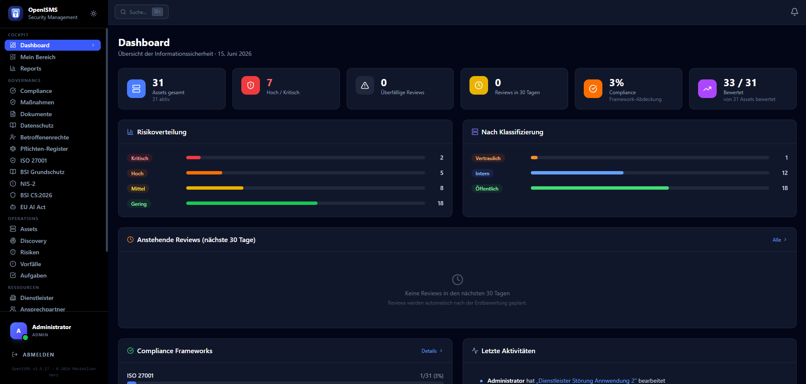

# OpenISMS Wiki

**OpenISMS** is an open, practice-oriented Information Security Management
System for ISO 27001, NIS-2 / BSIG, GDPR, BSI IT-Grundschutz, BSI C5, TISAX,
DORA and the EU AI Act. It runs as a single container with PostgreSQL and is
built for organisations that want to keep their ISMS data on their own
infrastructure.

---

## Start here

| I want to … | Read |
|---|---|
| Try OpenISMS in ten minutes | [Getting Started](Getting-Started) |
| Install it for real | [Installation and Configuration](Installation-and-Configuration) |
| Run it securely in production | [Security Configuration](Security-Configuration) |
| Know what it can do | [Features](Features) |
| Connect Claude or another AI assistant | [MCP Integration](MCP-Integration) |
| Update to a new version | [Upgrading](Upgrading) |
| Fix a problem | [Troubleshooting](Troubleshooting) and [FAQ](FAQ) |
| Understand how it is built | [Architecture](Architecture) |
| Look up a German or regulatory term | [Glossary](Glossary) |
| Contribute code or translations | [Contributing](Contributing) and [Translation Style Guide](Translation-Style-Guide) |
| Report a vulnerability | [Security Policy](Security-Policy) |
| See what changed | [Release Notes](Release-Notes) |

---

## OpenISMS at a glance

- **One register for everything:** assets, risks, controls, policies,
  incidents, vendors and evidence reference each other. One control can satisfy
  ISO 27001, NIS-2, BSI and C5 requirements at the same time.
- **Evidence, not checkboxes:** every change is audit-logged and signed,
  documents are hash-verified, and the relationship analysis shows *why* a
  requirement counts as met.
- **Made for German and European requirements:** NIS-2 together with the
  German BSIG duties, BSI IT-Grundschutz with information domains and the
  IT-Grundschutz check, C5:2026, TR-02102 figures, GDPR processing register and
  DPIA.
- **Technically grounded:** CVE matching, network and agent discovery,
  CheckMK, threat feeds — the register reflects what actually runs.
- **AI-ready:** a built-in MCP server lets assistants such as Claude work with
  the ISMS under the same permissions as every user.
- **Self-hosted:** one container plus PostgreSQL. Your data stays with you.

## Project links

- [Source code](https://github.com/GRCForge/OpenISMS)
- [Releases and container images](https://github.com/GRCForge/OpenISMS/releases)
  — image `ghcr.io/grcforge/openisms-app`
- [Issues](https://github.com/GRCForge/OpenISMS/issues) — please report
  vulnerabilities privately, see [Security Policy](Security-Policy)

OpenISMS is source-available software: free for private and non-commercial use;
commercial use and redistribution require a licence. See the
[licence](../LICENSE).
